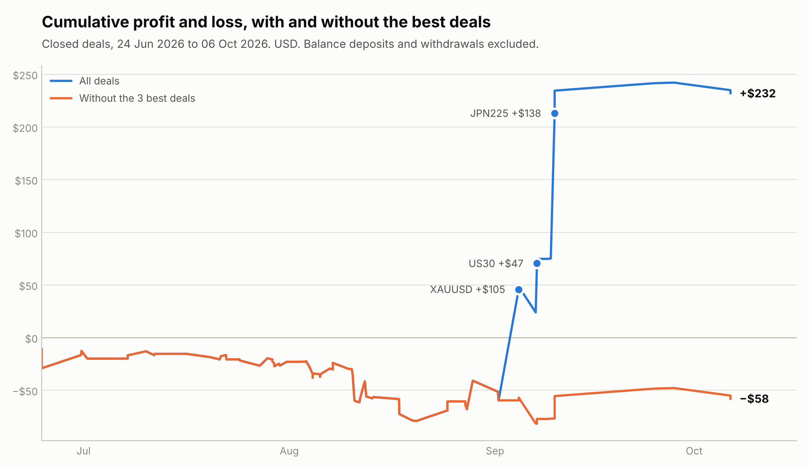
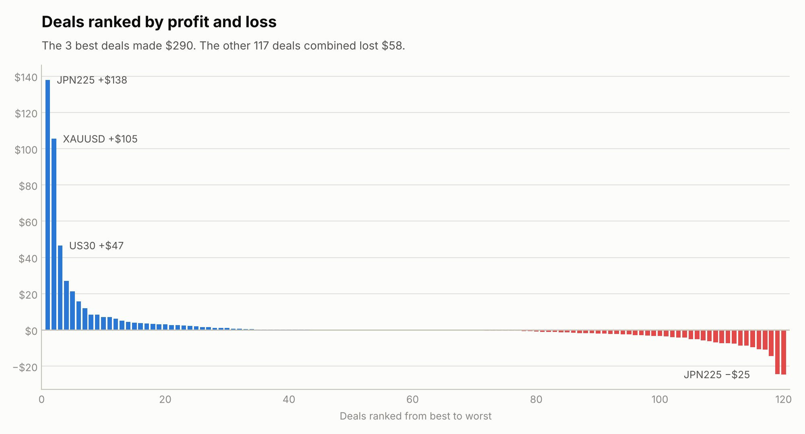
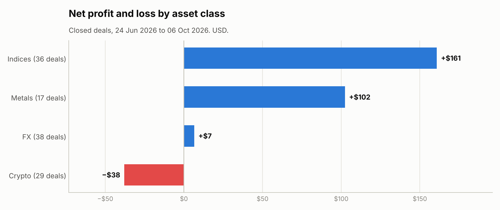

# Trade Performance Audit

A small Python project that asks one honest question about my own trading: **is my profit a repeatable edge, or a few lucky trades?**

It reads a cTrader deals statement (CSV), computes core performance numbers, tests whether the results survive without the best deals, breaks results down by asset class, and saves charts plus a written report.

## What I found

Statement period: 24 Jun to 6 Oct 2026, 120 closed deals, net **+$231.96**.

| Metric | Value |
|---|---|
| Win rate (per deal) | 49.2% |
| Average win / average loss | +$7.75 / −$3.82 (payoff ratio 2.03) |
| Profit factor | 2.03 |
| Expectancy per deal | +$1.93 |
| Longest losing streak | 7 deals |

The headline numbers look healthy, but the robustness tests tell a more careful story:

- **The profit is concentrated.** My 3 best deals (JPN225, gold, US30) made $290. The other 117 deals combined lost $58.
- **The bootstrap cannot rule out zero.** Resampling the deals 10,000 times puts the average deal between −$0.70 and +$5.36 (95% range).
- **By asset class:** indices +$161, metals +$102, FX +$7, crypto −$38.

My reading: the payoff profile is asymmetric (winners about twice the size of losers), which is encouraging, but 120 deals with this much concentration is not enough to call it an edge yet. The sample needs to grow.





Full tables are in [`outputs/results.md`](outputs/results.md).

## What I changed because of this

The audit showed gaps in how I managed risk, so I formalised a risk framework in October 2026: maximum 1% risk per trade and maximum 5% combined open risk. The plan is to re-run this audit on new trades to see whether the framework changes the results.

## How to run

```bash
pip install -r requirements.txt
python audit.py data/statement.csv --out outputs
```

Put your own cTrader statement in `data/` (that folder is git-ignored, because statements contain balances). Options: `--boot` sets the number of bootstrap resamples and `--seed` makes the random resampling repeatable.

## Method notes

- **Profit factor** is gross profit divided by gross loss. **Payoff ratio** is average win divided by average loss.
- **Robustness test:** remove the best 1, 3 and 5 deals and recompute net profit.
- **Bootstrap:** resample deals with replacement 10,000 times and look at the spread of the average P&L per deal.
- **Drawdown** is measured in dollars on cumulative deal P&L.

## Limits

- The statement has closing times only, with no opening time and no stop-loss, so holding periods and risk per trade (R-multiples) cannot be measured from it.
- A position closed in parts appears as several deals, so counts and win rate are per deal, not per trade.
- Balance changes from deposits and withdrawals are not in the data, so a percentage return cannot be computed from this file.
- Small sample, and deals are not fully independent.

## Next

- Add opening time and stop-loss data to measure R-multiples and holding periods
- Re-run monthly as the sample grows
- Second project: an honest backtest of a simple strategy, including drawdowns
